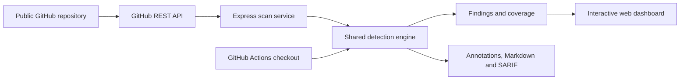

# GitHub GRC

### Repository Security Analysis & Developer Review Platform

GitHub GRC brings repository scanning, prioritised security findings and commit monitoring into one developer workspace. It inspects public GitHub source files for credential-exposure patterns, connects each finding to its source file, and provides structured guidance for review.

The platform combines a Node.js scanning service, an interactive dashboard and a GitHub Action built around a shared detection engine.

[Open hosted application](https://github-grc.onrender.com/) · [Local setup](#local-setup) · [Architecture](#architecture) · [Testing](#testing)

## Core capabilities

| Area | Capabilities |
| --- | --- |
| Repository analysis | Public-repository inspection at an immutable commit, supported-text filtering and explicit coverage reporting. |
| Credential detection | Rules for AWS credential patterns, private-key headers, API keys, token assignments, password/secret assignments and configuration references. |
| Findings workspace | Severity-first ordering, source filenames, expandable finding details, paginated results and remediation examples with copy/download controls. |
| Scan experience | Four-stage workflow, animated completion states, responsive layout and reduced-motion support. |
| Commit monitoring | Browser-based commit checks, revision-specific rescans, new-finding alerts, cancellation and retry handling. |
| Development workflow | GitHub Action with changed-line or full scanning, line-level annotations, Markdown reports, configurable severity gates and SARIF output. |
| Resilience | Bounded parallel downloads, one retry for transient file-fetch failures, request timeouts, quota-aware scheduling and sanitised error responses. |

## How scanning works

1. **Resolve the repository.** Validate the URL, confirm public visibility and resolve the requested revision to a commit SHA.
2. **Read the source.** Retrieve the file tree and download eligible text files with bounded concurrency. Tree and file requests use the same commit.
3. **Apply detection rules.** Evaluate file contents with the shared JavaScript rule engine and assign finding severities.
4. **Build the report.** Return findings, repository metadata, a triage score and coverage details. The dashboard presents the highest-severity findings first.
5. **Monitor changes.** When monitoring is enabled, check for a new commit and scan that revision. Failed rescans retain their previous baseline for retry.

The default website scanning path uses deterministic rules and the GitHub REST API. It does not require an LLM or send repository snippets to an AI provider.

## Architecture



| Component | Technology |
| --- | --- |
| Runtime and API | Node.js 24, Express |
| GitHub integration | GitHub REST API, Axios |
| Detection and reporting | Shared JavaScript modules |
| Frontend | HTML, CSS, JavaScript |
| Automated verification | Node.js test runner, jsdom, isolated Git fixtures |
| CI and hosting | GitHub Actions, Render |

## Local setup

**Requirements:** Git, npm and Node.js 24.15 or newer within the 24.x release line.

```bash
git clone https://github.com/Shreshth114/Github-GRC.git
cd Github-GRC
npm ci
cp .env.example .env
```

Set your GitHub token in `.env`:

```dotenv
GITHUB_TOKEN=
```

Use a read-only, narrowly scoped token appropriate for the public repositories being scanned. The server supports unauthenticated GitHub requests when no token is configured, subject to GitHub's lower request allowance.

Start the application:

```bash
npm start
```

Open [http://localhost:3000](http://localhost:3000/), enter a public repository URL and select **Execute Scan**. Select **Start Live Monitoring** to watch for new commits and **Stop Monitoring** to end polling.

### Environment variables

| Variable | Purpose | Default |
| --- | --- | --- |
| `GITHUB_TOKEN` | Server-side GitHub API authentication; recommended for regular scanning. | Unauthenticated requests |
| `PORT` | HTTP listening port. | `3000` |

Credentials stay on the server. Keep `.env` outside version control; `.env.example` contains no secret values.

## API

| Endpoint | Request | Result |
| --- | --- | --- |
| `POST /scan` | `repoUrl`, optional 40-character `commitSha` | Findings, score, repository revision and scan coverage. |
| `POST /latest-commit` | `repoUrl`, optional `branch` | Latest commit SHA for the selected or default branch. |

Example scan request:

```json
{
  "repoUrl": "https://github.com/owner/repository"
}
```

Responses distinguish missing repositories/references, permission failures, invalid server credentials, rate limits and timeouts. Incomplete reports retain their coverage counts and sanitised failed-file details.

## GitHub Actions integration

The included [security workflow](.github/workflows/security-scan.yml) installs dependencies, runs the test suite and invokes the local [Security Agent](action.yml).

- Push scans compare against the event's preceding commit.
- Pull-request scans compare against the base branch and report matching changed lines.
- `scan-mode` supports `diff-only` and `full`.
- `severity-threshold` and `fail-on-findings` control the check; the included workflow fails on HIGH findings.
- Reports include severity counts, file/line references and optional SARIF output. Code Scanning uploads depend on GitHub repository availability and permissions.
- Annotations and Markdown reports omit raw matched source snippets that could contain credentials.

The Action also contains an optional OpenAI triage integration. It is disabled by default, is separate from website scanning and requires additional validation before enabling. Groq and Gemini keys are not used by this project.

## Testing

```bash
npm test
```

The suite covers API validation, public/private repository boundaries, commit pinning, error mapping, bounded concurrency, transient retries, quota stops and coverage accounting. Frontend tests cover monitoring races, cancellation, severity ordering, pagination, disclosure state, history, copy/download controls and scan animations.

Tests use mocked GitHub responses and temporary synthetic repositories; real credentials are not required. DOM interaction tests verify behavior separately from visual browser review.

Detailed verification records:

- [API and monitoring reliability](docs/GRC_RELIABILITY_FIXES.md)
- [Four-stage scan workflow](docs/GRC_SCAN_TIMELINE.md)
- [Local findings workspace](docs/LOCAL_FINDINGS_UI.md)
- [Local parallel scanning and coverage](docs/LOCAL_PARALLEL_SCANNING.md)

## Scan coverage and interpretation

The web service currently supports:

| Setting | Limit |
| --- | --- |
| Eligible text files per scan | 300 |
| Size per file | 300,000 bytes |
| Scan time budget | 45 seconds |
| Parallel file downloads per scan | 5 |
| Simultaneous scans | 2 |
| Transient file-download retries | 1 |

Monitoring schedules its next check five seconds after the preceding check and scan finish. It runs in the browser rather than as a persistent background service.

Findings identify patterns that require source review. Documentation, examples and configuration references can match a rule without exposing a usable credential. Web findings are recorded per matched rule per file; Action findings include matching lines, so their counts can differ.

The score starts at 100, deducts 25 per HIGH finding, 10 per MEDIUM finding and 2 per LOW finding, and is bounded at zero. It supports triage; it does not measure exploit probability or certify compliance. Remediation snippets are illustrative examples for developer review.

## Deployment and project structure

The application runs as a single Express service on Render, reads the platform `PORT` and serves the frontend from `public/`. Configure `GITHUB_TOKEN` through the service's environment settings. The current free service can sleep when idle.

The hosted application reflects the published version. Recent findings and parallel-scanning improvements are pending review and are not yet part of the hosted deployment; their implementation records are linked above.

```text
server.js                    API routes, GitHub access and scan orchestration
public/                      Dashboard, monitoring and scan presentation
lib/scanner.js               Shared detection rules and scoring
lib/reporter.js              Markdown, JSON and SARIF reporting
lib/llm-analyzer.js           Optional Action triage integration
agent/                       Git diff handling, annotations and PR reports
action.yml                   GitHub Action inputs and outputs
.github/workflows/           CI workflow
tests/                       API, frontend, scanner and Action regressions
docs/                        Implementation and verification records
```
